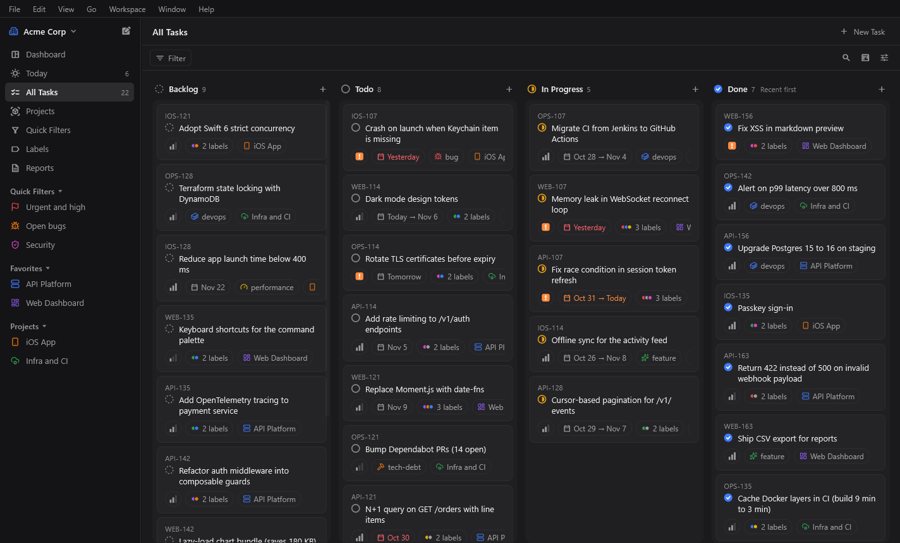
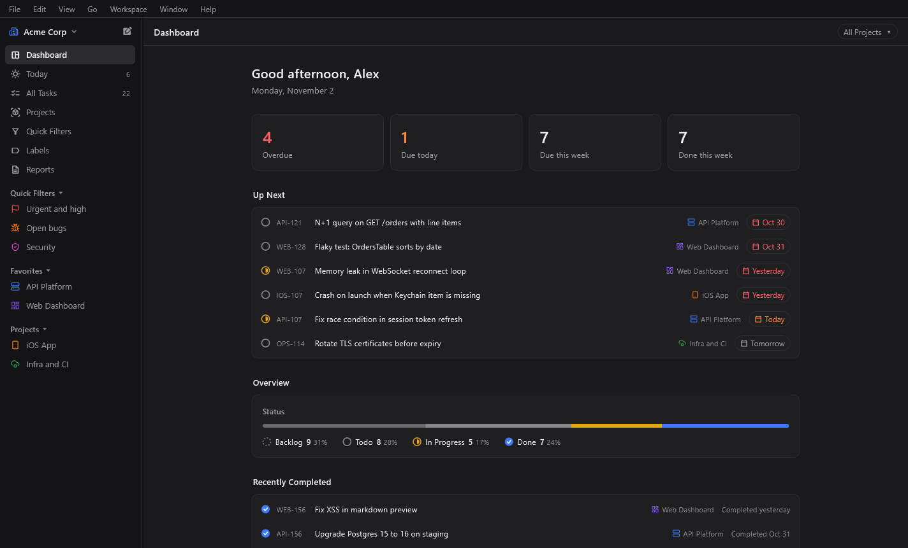
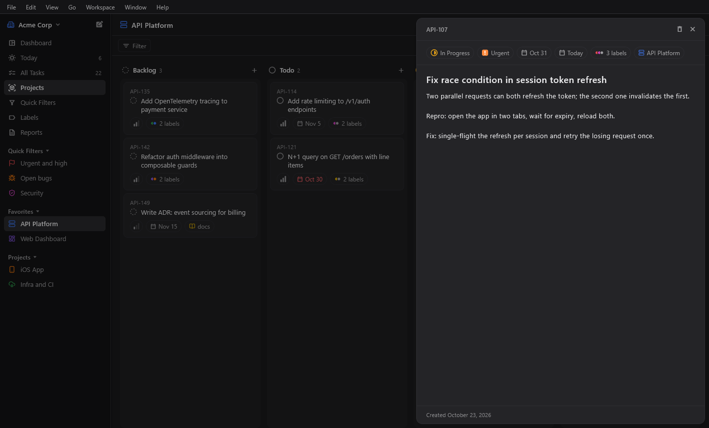
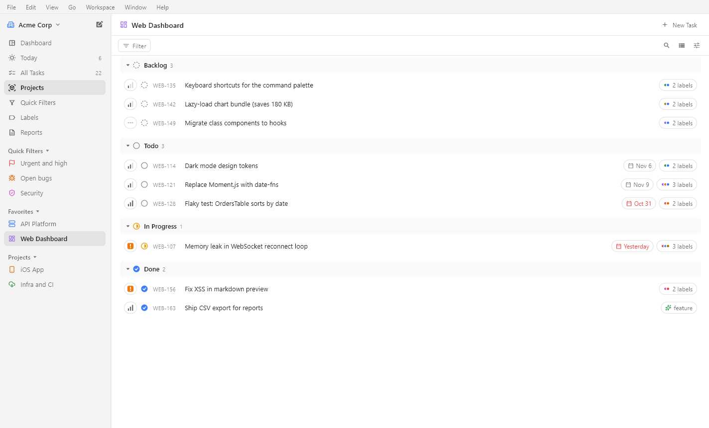
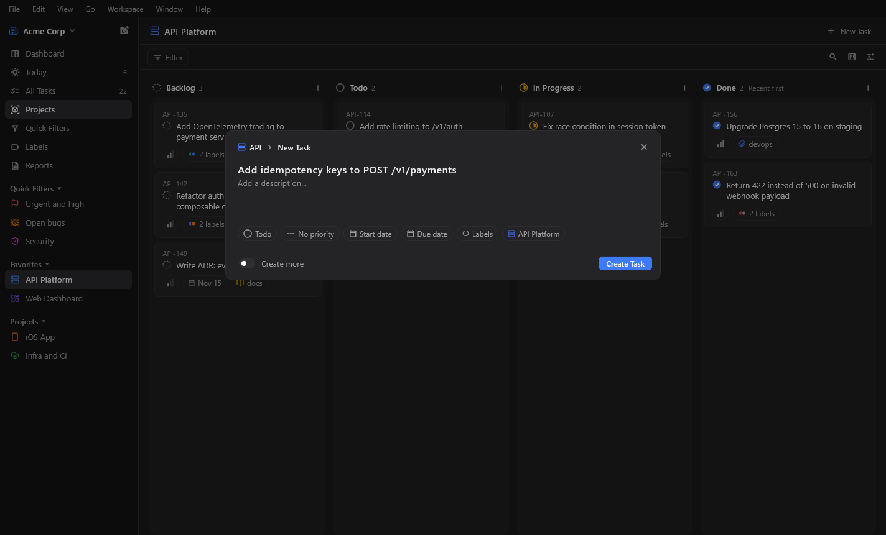
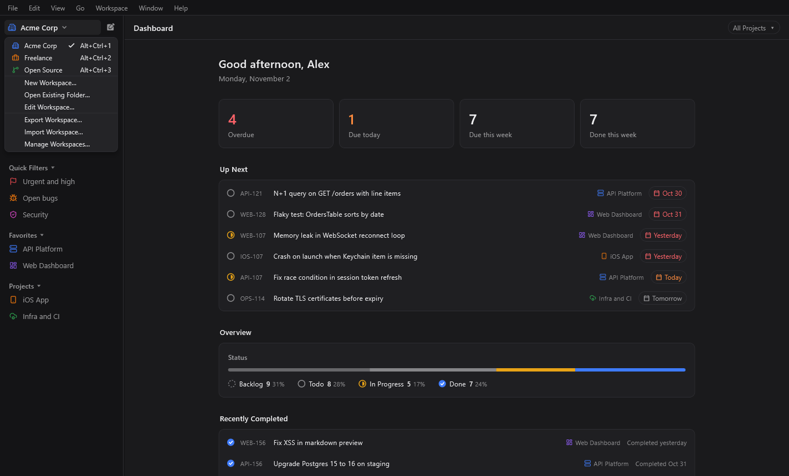
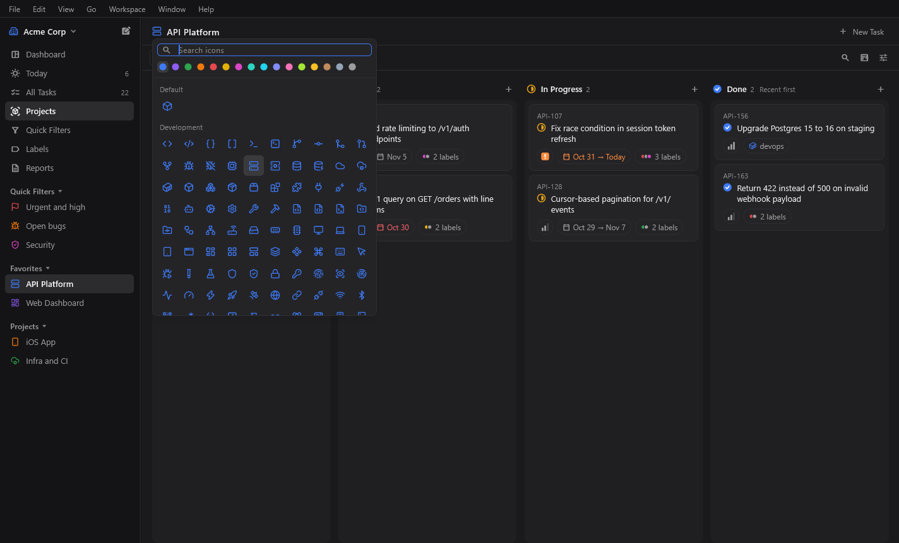
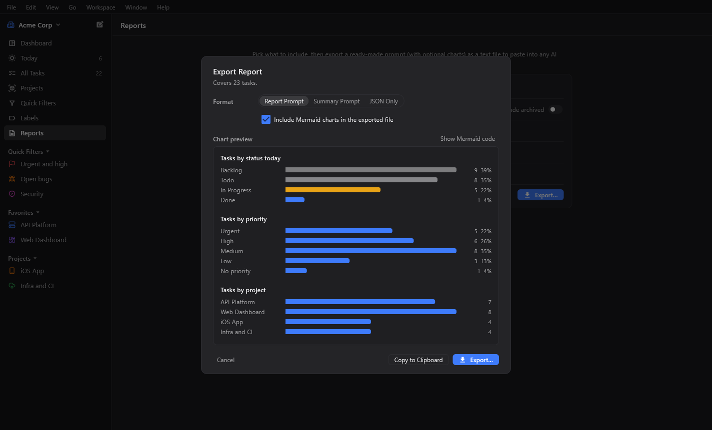

<p align="center">
  
</p>

<h1 align="center">Tasklet</h1>

<p align="center">
  A calm, keyboard-first, local-first task tracker for one person.<br>
  Your tasks are plain files in a folder you choose. No account, no server, no telemetry.
</p>

<p align="center">
  <a href="https://github.com/aasifashraf/tasklet/releases">Download</a> ·
  <a href="docs/SPEC.md">Specification</a> ·
  <a href="CONTRIBUTING.md">Contributing</a> ·
  <a href="LICENSE">MIT License</a>
</p>

<p align="center">
  
</p>

---

## What is Tasklet?

Tasklet is a single-player task tracker inspired by the speed and look of tools like Linear, but intentionally
simpler: no teams, no assignees, no accounts. Everything you create (tasks, projects, labels and quick filters) is stored
as plain JSON files in a folder on your computer. Keep separate folders as **workspaces** (your employer, freelance
clients, open source) and switch between them in one click.

Put that folder inside OneDrive, Dropbox, Google Drive, iCloud Drive or Syncthing, and your tasks follow you between
computers without any Tasklet server. If you stop using Tasklet one day, your data is still readable text.

**Platforms:** Windows 10 and 11 today. macOS is built from the same code and is being tested; iOS and Android are
planned.

## Screenshots

| | |
|---|---|
|  |  |
| **Dashboard:** what's overdue, due today and coming up, plus what you finished. | **Detail panel:** every property as a chip; title and description save as you type. |
|  |  |
| **List layout and light theme:** compact rows grouped by status. | **New Task (Ctrl+N):** type a title, set properties with chips, press Enter. |
|  |  |
| **Workspaces:** each one is its own folder; switch at the top of the sidebar or with Ctrl+Alt+1 … 9. | **Icons and colors:** about 640 project-related icons and 16 colors for projects, labels and quick filters. |
|  | |
| **Reports:** preview charts, then export a prompt for any AI assistant. | |

## Features

### Organize
- **Workspaces** keep separate lives apart: your employer, freelance clients, open source. Each one is its own
  folder with its own projects, labels and quick filters, so each can sync through a different service (the company
  OneDrive, your personal Dropbox). Switch at the top of the sidebar or with Ctrl+Alt+1 … 9, move a project
  to another workspace from its menu, and export or import a whole workspace as one file.
- **Projects** with a short, permanent key, so every task gets an ID like `WEB-12` that never changes, even after a
  rename.
- **Tasks without a project** are allowed and get IDs like `TSK-3`.
- **Labels** for the whole workspace or for one project.
- **Icons and colors** for projects, labels and quick filters: about 640 project-related icons (Lucide) with
  search, and 16 colors.
- **Favorites** pinned at the top of the sidebar, and an **archive** for finished projects.
- **Quick filters**: save any combination of filters and open it in one click, optionally pinned to the sidebar. A
  quick filter's filters and display settings are stored in your data folder, so it looks the same on every computer.

### Work
- **Board** with four columns (Backlog, Todo, In Progress, Done). Drag cards between columns to change status, or
  drag within a column to reorder by hand. Cards lift, tilt and settle smoothly, and Escape cancels a drag.
- **List** layout with collapsible, sticky status sections. Switch between board and list with one click.
- **Sorting** by manual order, priority, due date, last updated or newest, in either direction.
- **Filters** by status, priority, project, label and due date, plus **search** across IDs, titles and descriptions
  (Ctrl+F).
- **Today** page with everything due today, starting today or overdue.
- **Dashboard** with a greeting, overdue and due-this-week counts, what's up next, a status overview and what you
  finished recently. It updates on its own when the date changes.

### Edit quickly
- **New Task** dialog (Ctrl+N) with status, priority, start date, due date, labels and project, plus "Create more"
  for entering several tasks in a row.
- **Detail panel** that slides in from the right and saves as you type.
- **Right-click menu** on every task: change status, priority, due date (Today, Tomorrow, Next Week), labels or
  project, duplicate, copy the ID, or delete.
- **Undo** for every change, including deletes. Task deletion never asks for confirmation because Undo is always
  there; deleting a project, label or view does ask.
- A task's start date can never be after its due date.

### Stay on track
- **Daily reminder**: one short notification a day at the time you choose, summarizing what's due today, what's
  overdue and (optionally) what's due tomorrow. Clicking it opens the task or the right page.
- Tasklet keeps running in the **system tray** when you close the window, so reminders still arrive. Starting it
  again simply brings the window back.

### Reports for any AI assistant
Turn on **Reports** in Settings → Sidebar. Pick a period (this week, last month, a custom range…), projects, labels,
statuses and priorities, and Tasklet shows how many tasks are included. **Export** writes a text file containing a
ready-made prompt (a full report or a short summary) plus the data, optionally with **Mermaid charts** you can preview
first. Paste it into the AI assistant you already use. Tasklet itself never calls an AI service or sends your data
anywhere.

### Make it yours
- Light, dark or automatic theme.
- Reorder or hide sidebar items (Settings → Sidebar).
- A separate Settings window with General, Sidebar, Notifications and Workspaces tabs.

## Download and install

Get the latest release from the [Releases page](https://github.com/aasifashraf/tasklet/releases):

| File | Use it if |
|---|---|
| `Tasklet-Setup-<version>.exe` | You want a normal install with a Start-menu entry and an uninstaller. No administrator rights needed. |
| `Tasklet-<version>-windows-x64-portable.zip` | You prefer to unzip and run `Tasklet.exe` without installing. |

The installer isn't code-signed yet, so Windows SmartScreen may show a warning the first time. Choose
**More info → Run anyway**.

## Getting started

1. Start Tasklet. On first launch it asks where to keep your data.
2. Choose **Create Workspace…** (name it, then pick where its folder goes, for example inside your OneDrive
   folder) or **Choose Existing Folder…** to open a folder you already use with Tasklet on another computer.
   Add more workspaces later from the top of the sidebar or the **Workspace** menu. A new workspace
   starts with four labels (bug, feature, refactor, security) and everyday quick filters (Overdue, Due Soon, High
   Priority, In Progress, No Due Date); your first one also has a sample **Tasklet** project showing Tasklet's own
   plan. Rename or delete any of it.
3. Create a project from the **Projects** page, then add tasks with **Ctrl+N**.

### Keyboard shortcuts

| Action | Shortcut |
|---|---|
| New task | Ctrl+N |
| New project | Ctrl+Shift+N |
| Search the current board | Ctrl+F |
| Delete the selected or open task | Delete or Ctrl+Backspace |
| Go to Dashboard, Today, All Tasks, … (sidebar order) | Ctrl+1 … Ctrl+7 |
| Switch to the first nine workspaces | Ctrl+Alt+1 … Ctrl+Alt+9 |
| Settings | Ctrl+, |
| Refresh from disk | F5 |
| Close the detail panel or cancel a drag | Esc |

On macOS, use ⌘ instead of Ctrl.

## Your data

Each workspace is one folder:

```text
<workspace folder>/
  tasklet-workspace.json     marker file: format version, and the workspace's name, icon and color
  labels.json                workspace labels
  views.json                 quick filters
  projects/
    <project-id>.json        one file per project, including its tasks
```

Tasklet is careful with these files because they may live in a syncing folder:

- **Safe saves:** every change is written to a temporary file first and then swapped in, so a crash or a sync client
  never sees a half-written file.
- **Never overwrites what it can't read:** a file that is still downloading or damaged is skipped, not replaced.
- **Sync conflicts are left alone:** if your sync service creates a second copy of a project, Tasklet shows the main
  version, leaves the copy untouched and tells you where it is.
- **Forward compatible:** fields or items written by a newer version of Tasklet are kept and written back unchanged.
  A folder saved by a newer, incompatible version opens read-only.
- **Deleted projects** go to the Recycle Bin (or a hidden `.trash` folder on drives without one).
- **Local backups:** before a project changes, its previous version is kept on this computer (at most one every 10
  minutes, the newest 20). **Restore Previous Version…** in a project's ⋯ menu brings one back.
- **Self-repair after syncing:** if two computers both created the same task number offline, the newer task gets
  the next free number, like duplicate project keys.
- **Missing folder:** if the folder disappears (for example a drive is unplugged), Tasklet tells you instead of
  starting an empty workspace.

The reasons behind these rules are in [docs/DECISIONS.md](docs/DECISIONS.md).

## Building from source

Requirements: [Flutter](https://flutter.dev) 3.47 or later (stable), and for Windows builds Visual Studio 2022 with the
"Desktop development with C++" workload.

```sh
git clone https://github.com/aasifashraf/tasklet.git
cd tasklet
flutter pub get
flutter run -d windows        # or: -d macos on a Mac
```

Useful commands:

```sh
flutter analyze               # static analysis (must be clean)
flutter test                  # unit and widget tests
flutter build windows --release
```

To build the Windows installer, install [Inno Setup](https://jrsoftware.org/isinfo.php), package the release build into
`dist/Tasklet`, then run `ISCC.exe /DAppVersion=<version> installer/tasklet.iss`.

## Project structure

```text
lib/
  core/       business rules in pure Dart: models, project keys, sorting, filters, dates,
              reports, reminder rules (no Flutter imports, fully unit tested)
  data/       the only code that touches files: workspace store, save queue,
              folder watcher, device settings
  state/      app state with Riverpod: workspace controller, boards, clock, undo, reminders
  ui/         theme, glyphs and the icon catalog, sidebar and workspace switcher, board and
              list, task dialog and panel, pages, settings window
  platform/   menus and shortcuts, windows, tray, notifications, Recycle Bin
test/         unit tests (core, data, state) and widget tests
tool/         benchmark (tool/bench) and the icon catalog generator (tool/icons)
docs/         SPEC.md (product specification), DECISIONS.md, ROADMAP.md, DESIGN_SYSTEM.md,
              SYSTEM_DESIGN.md, PERFORMANCE.md
installer/    Inno Setup script for the Windows installer
```

**Built with:** Flutter, Riverpod, go_router, window_manager, desktop_multi_window, tray_manager,
flutter_local_notifications, file_picker, watcher and [Lucide](https://lucide.dev) icons.

## Roadmap

- macOS release (signing and notarization)
- Code-signed Windows installer
- iOS and Android with a layout adapted to small screens

See [docs/ROADMAP.md](docs/ROADMAP.md) for details.

## Contributing

Bug reports, ideas and pull requests are welcome. Please read [CONTRIBUTING.md](CONTRIBUTING.md) first; the
product behavior is defined in [docs/SPEC.md](docs/SPEC.md).

## License

Tasklet is open source under the [MIT License](LICENSE).
