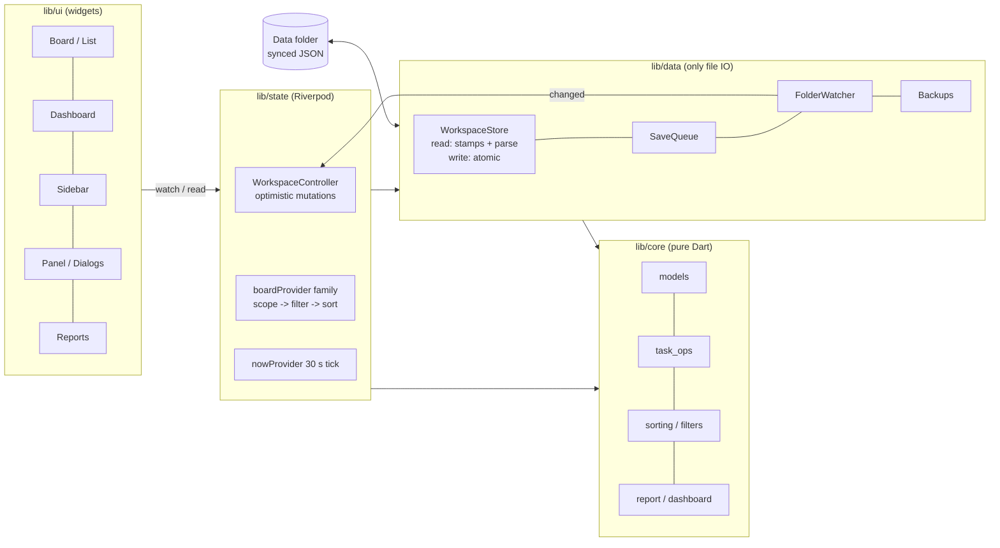
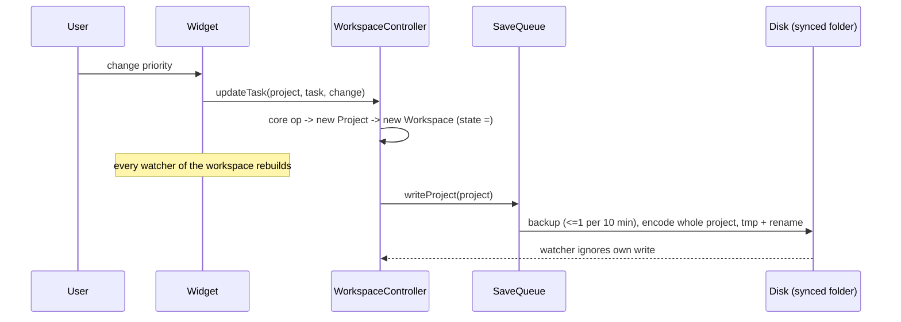
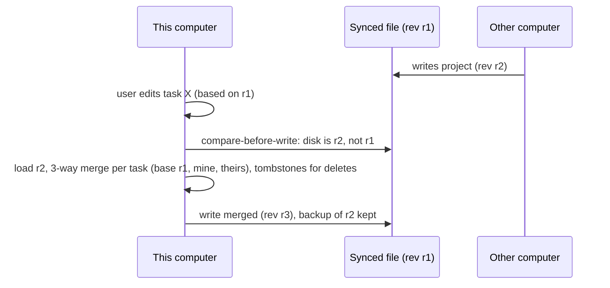

# Tasklet system design: performance and scalability review

Status: **proposal for review**. Nothing described under "Proposed" is implemented. Measurements were taken on
2026-11-02 against commit `22eb90d`.

Labels used throughout: **[Existing]** what the code does today, **[Problem]** a measured or verified weakness,
**[Proposed]** a recommended change, **[Optional]** worth doing only if a trigger is met, **[Unverified]** an
assumption that still needs measurement.

---

## 1. Executive summary

Tasklet is a Flutter desktop app (Windows now, macOS built, mobile planned) whose **source of truth is a folder of
plain JSON files** that users may put in OneDrive, Dropbox, iCloud or Syncthing. The whole workspace is parsed into
immutable Dart objects and held in memory; every screen derives its data from that snapshot.

Measured on this machine (Ryzen 7 7735HS, NVMe, 13 GB RAM), the design is comfortably fast up to about **10,000
tasks**. At **100,000 tasks** several operations break the 50 ms main-thread budget: the Dashboard takes **1.2 s and
recomputes every 30 seconds**, the All Tasks board ~120-170 ms, search 170-300 ms per change, a cold open 2.3 s.
At **500,000 tasks** the in-memory model is clearly out of range: 11.6 s to open, a 4.7 s dashboard, ~1 s board recomputes and searches, 1.2 GB of memory (~2.4 KB per task).

The two non-negotiable constraints shape every option:

1. **The data folder must stay plain files that a sync service can copy.** SQLite's own documentation warns against
   live databases on network or synced storage (WAL does not work on network filesystems; copying a database
   without its journal mid-transaction corrupts it). So a database cannot replace the JSON folder without dropping
   the product's core promise.
2. **Correctness first.** The current sync model (whole-file last writer wins) can lose an edit when two computers
   change the same project; that matters more to users than speed at 500k tasks.

**Recommendation** (justified in section 22):

- **v1.1, now: keep JSON + in-memory snapshots, make them incremental, and fix the sync model.** Specifically:
  revision-checked writes, per-task merge with tombstones, per-project precomputed aggregates, split board
  providers, precomputed local dates, and the remaining work off the UI thread. Every measured >50 ms operation at
  100k has a concrete, low-risk fix here, and none needs a new dependency.
- **v2, only if 100k+ workspaces become a real target: add a local SQLite read index** (in the app-data folder,
  never in the synced folder), rebuilt from the JSON files, for instant startup, paged queries and FTS5 search.
  JSON stays the source of truth. A storage-format change (chunked project files) would come with it.
- **Do not** move the source of truth into a database, adopt Isar-family stores (original project discontinued) or
  add caching layers beyond what measurements justify.

---

## 2. Existing architecture assessment

### 2.1 Platform and stack [Existing]

| Concern | What the repository uses |
|---|---|
| Language / UI | Dart 3.13, Flutter 3.47, Material widgets with custom tokens (`lib/ui/theme.dart`) |
| Targets | Windows (shipping), macOS (built, untested on a Mac), iOS/Android planned (`docs/ROADMAP.md`) |
| State | Riverpod 3 (`Notifier`, `Provider.family`), one `WorkspaceController` (`lib/state/workspace.dart`) |
| Navigation | go_router |
| Storage | JSON files via `dart:io`: `tasklet-workspace.json`, `labels.json`, `views.json`, `projects/<id>.json` |
| Device settings | one `settings.json` in the app-data folder, shared by the main and Settings engines (`lib/data/prefs_store.dart`) |
| Concurrency | per-path serialized `SaveQueue`, atomic tmp+rename writes, folder watcher with debounce + max-wait |
| Background work | `Isolate.run` for parsing changed files > 256 KB and encoding projects > 2,000 tasks |
| Backups | local version history in the app-data folder (D12) |
| Tests | 183 unit/widget tests; ad-hoc benchmark scripts (not yet in the repo) |

### 2.2 Layering [Existing]



Layering is clean: `lib/core` has no Flutter imports, `lib/data` is the only file IO, UI never touches files.

### 2.3 Data flow of one edit [Existing]



### 2.4 Entities that actually exist [Existing]

| Entity | Where | Notes |
|---|---|---|
| Task | inside its project file | id, number, title, description, status, priority, start/due date, labelIds, sortOrder, created/updated/completedAt, `extra` |
| Project | `projects/<id>.json` | key, color, archived, favorite, orders, own labels, nextNumber, tasks, opaque entries |
| No Project bucket | `projects/no-project.json` | lazy file, key TSK |
| Label | `labels.json` (workspace) or in a project | 8 colors |
| Quick filter (SavedView) | `views.json` | filters + display, sidebar pin/order |
| Status, Priority | enums | 4 statuses, 5 priorities |
| Device settings | app-data `settings.json` | theme, sidebar, reminders, per-board display |
| Backups | app-data `backups/` | file versions, newest 20 |

Not present today (candidate entities from the brief): subtasks, recurring tasks, attachments, task history, tags
separate from labels, categories, reminders per task (only a daily digest), task-level archive (only projects),
trash records (deleted tasks live in a 50-entry in-memory Undo cache; deleted projects go to the OS Recycle Bin).

---

## 3. Measured performance today

Method: `bench_scale.dart` (scratchpad) calls the app's real `WorkspaceStore` and `lib/core` functions on generated
workspaces: 200 projects, the largest holding 20% of tasks, 30% of tasks with short descriptions, 1% with 4 KB
descriptions, 200 labels. "UI stall" is the longest gap a 1 ms timer on the main isolate experienced, i.e. how
long the UI thread would have been frozen. Each row is p50 / p95 over 1-5 runs (single runs show one number).
Widget build and paint time is **not** included; real frame cost is higher [Unverified until profiled].

| Operation | 10k tasks | 50k tasks (Nov 1, larger descriptions) | 100k tasks | 500k tasks |
|---|---|---|---|---|
| Data on disk | 6 MB | 112 MB | 59 MB | 290 MB |
| Open (first read) | 396 ms, stall 34 | ~4.8 s, stall 695 (incl. 150 key repairs) | 2.3 s, stall 183 | 11.6 s, stall 973 |
| Refresh, nothing changed | 58 ms, stall 21 | 30 ms, stall 16 | 202 / 258 ms, stall 196 | 894 / 1,102 ms, stall 1,057 |
| All Tasks board (filter + group + sort) | 6 / 25 ms | ~70-120 ms | 121 / 167 ms | 890 / 1,010 ms |
| Largest project board | 0 / 1 ms | | 11 / 17 ms | 75 / 125 ms (100k-task project) |
| Search, first query | 40 ms | 560 ms (36 MB of descriptions) | 301 ms | 1,380 ms |
| Search, next keystroke | 11 / 15 ms | 352 ms | 174 / 203 ms | 724 / 770 ms |
| **Dashboard aggregates** | **90 / 114 ms** | | **1,241 / 1,316 ms** | **4,650 / 4,737 ms** |
| Sidebar open count | 1 / 2 ms | | 9 / 22 ms | 35 / 55 ms |
| Label usage map | 2 / 8 ms | 23 ms | 39 / 61 ms | 151 / 211 ms |
| Edit one task (in memory) | 0 / 8 ms | | 4 / 20 ms | 12 / 30 ms |
| Save largest project | 49 / 87 ms, stall 73 | 942 ms, stall 195 (44 MB file) | 571 / 728 ms, stall 140 | 2,679 / 2,820 ms, stall 631 (100k-task project) |
| Save typical project | 6 ms | | 14 / 15 ms | 52 / 83 ms |
| Peak process memory | 272 MB | 777 MB | 441 MB | 1,207 MB |

---

## 4. Identified bottlenecks

Ordered by user impact at 100k tasks. Each is verified in code.

| # | Problem | Evidence | Why |
|---|---|---|---|
| P1 | **Dashboard: 1.2 s, repeated every 30 s** | table above; `dashboard_page.dart:28` watches `nowProvider` (30 s tick) and computes `glanceFor`, `upNext`, `recentlyCompleted` in `build()` | `_completedWithinLastWeek` (`core/dashboard.dart:19`) calls `LocalDate.fromDateTime` twice per task (task time and `now`), each a `toLocal()` timezone conversion, and it runs twice per task (glance + recent): ~4 conversions x 100k |
| P2 | All Tasks / quick filter boards 120-170 ms per recompute | `state/boards.dart:176-191` watches the whole workspace, whole prefs and whole session maps | any edit, pref change or other board's search rebuilds and re-sorts every board in scope |
| P3 | Search 170-300 ms per change | `SearchQuery` scans every task's lowercased title + description | linear scan; already debounced 200 ms so typing stays smooth, but results lag |
| P4 | Whole-project rewrite per edit | `WorkspaceStore.writeProject` encodes the full project | a 20k-task project = 0.57 s CPU + 140 ms UI stall (copying to the encode isolate) per save, and a 8-40 MB upload for the sync client |
| P5 | Cold open grows linearly | 2.3 s at 100k, parse on a background isolate | everything is parsed and kept resident (~3 KB per task) |
| P6 | Refresh with nothing changed: 200 ms at 100k (196 ms stall), ~1 s at 500k (1,057 ms stall) | measured; the read returns the cached snapshot, so no parsing happens | grows with heap size, not file count (200 files in both runs): [Unverified] most likely garbage collection of the large resident heap; needs a DevTools profile before choosing a fix |
| P7 | Sync correctness: whole-file last writer wins | `docs/DECISIONS.md`, `writeProject` overwrites from memory | two computers editing different tasks of one project lose one side's edit when the second save lands; a foreign change within the 2 s own-write window is ignored until the next focus |
| P8 | Refresh deferred while any file is saving | `SaveQueue.inFlight` is global | continuous saving (typing) postpones all external refreshes |
| P9 | Reports and exports rebuild everything in `build()` and copy every description | `reports_page.dart`, `report.dart` | fine at 10k; [Unverified] large at 100k+ |
| P10 | Pickers build every label/project menu item | `ui/task/pickers.dart` | 200+ labels = slow menu open, no search |

Things that are **already handled** (verified): lazy lists (`ListView.builder`, `SliverList.builder`), parse and
large encodes off the UI thread, incremental re-parse by file stamp, unchanged refresh skips rebuilds, label lookups
and usage memoized per snapshot, search query parsed once with cached lowercase text, debounced search box,
atomic writes, unreadable files never overwritten, backups, duplicate-key/number/task repairs.

---

## 5. Requirements

### Functional (unchanged from SPEC)
Boards (4 statuses, manual and sorted orders), list layout, filters, search, quick filters, dashboard, today,
labels, reports, reminders, undo, multi-computer use through a synced folder.

### Non-functional (targets are engineering hypotheses to verify, not promises)

| Area | Target | How measured |
|---|---|---|
| Main-thread blocking | no single task > 50 ms in normal use; > 16 ms only for user-initiated, infrequent actions | 1 ms ticker stall metric in benchmarks; DevTools timeline in profile mode |
| Frames | 60 fps (16 ms build + 16 ms raster budget) while scrolling boards/lists; 120 Hz where the display allows | `flutter run --profile`, `integration_test` `traceAction` frame summaries (p90/p99 build and raster times) |
| Optimistic edit feedback | next frame (< 16 ms from input to state change) | benchmark of the state transition + widget test |
| Board recompute | p95 < 50 ms at 100k tasks in scope | benchmark |
| Search results | p95 < 100 ms at 100k tasks after the debounce | benchmark |
| Dashboard | p95 < 30 ms at 100k; no periodic recompute of unchanged data | benchmark |
| Cold open to first interactive frame | < 1 s at 10k, < 3 s at 100k (v1.1); < 1 s at 100k+ (v2 with index) | stopwatch from `main()` to first `ReadyState` frame |
| Save | UI stall < 16 ms for any project size; total < 200 ms for a typical project | benchmark |
| Memory | < 300 MB at 10k, < 600 MB at 100k (v1.1) | peak RSS in benchmark and Task Manager |
| Data safety | no silent loss of a user's edit, including two computers editing one project | tests with simulated concurrent writers |

---

## 6. Storage options (technology comparison)

The question is not "which database is fastest" but "what can live in, or next to, a folder a sync client copies".

| Option | Fits "plain files in a synced folder"? | Strengths | Weaknesses | Migration cost |
|---|---|---|---|---|
| **A. JSON files as source of truth + in-memory model (today)** | Yes | readable, diffable, any sync service, no dependency, simple | whole-file writes, linear scans, all data resident | none |
| **B. A + local SQLite read index in app-data** | Yes (index is never synced) | instant startup (skip unchanged files), SQL counts/aggregates, paging, FTS5 search, bounded memory | two representations to keep consistent, rebuild/migration code, native library in the bundle (`package:sqlite3` now ships SQLite via build hooks), ~1-2 MB binary | medium |
| **C. SQLite as source of truth in the synced folder** | **No** | fastest queries | SQLite warns: WAL does not work on network filesystems; copying a database without its journal, or mid-transaction, corrupts it; sync clients do exactly that | very high, breaks the product promise |
| **D. SQLite source of truth locally + sync engine exporting JSON/CRDT** | Partly | fast, transactional | Tasklet becomes a sync product (conflict resolution, change log, export cadence); the folder is no longer the truth users can edit | very high |
| **E. Embedded NoSQL (Isar forks, ObjectBox, Hive)** | Same problems as C/D | fast object stores | original Isar discontinued (community forks of uneven health); ObjectBox is a commercial-backed binary; none solves the sync-folder constraint | high |
| **F. Change the file layout (chunked project files or one file per task)** | Yes | edits rewrite KBs instead of MBs; smaller sync uploads; fewer conflicts | format version bump (older apps go read-only by design), many more files for the sync client, more stat calls | medium |

**Conclusion:** A stays the source of truth. B is the scaling path when needed. F complements B for very large
projects. C, D and E are rejected for this product.

Sources: SQLite, [How To Corrupt An SQLite Database File](https://docs.w3cub.com/sqlite/howtocorrupt); SQLite
[Write-Ahead Logging](https://www.sqlite.org/docsrc/artifact/c89f81aeeef8bda1) ("WAL does not work over a network
filesystem"); [package:sqlite3 changelog](https://pub.dev/packages/sqlite3/versions/3.4.0/changelog) (build hooks,
no more `sqlite3_flutter_libs`); [drift platform docs](https://drift.simonbinder.eu/platforms); Isar status:
[isar_db](https://pub.dev/packages/isar_db), [isar_community](https://pub.dev/packages/isar_community/changelog).

---

## 7. Proposed architecture

### 7.1 Overview

```mermaid
flowchart TB
  subgraph UI
    W[Widgets\nselect exactly what they show]
  end
  subgraph State
    SES[WorkspaceSession\nopen / refresh / watch / merge]
    ACT[WorkspaceActions\nthin: core op -> put -> save]
    IDX[WorkspaceIndex per snapshot\nper-project aggregates, task map,\nlocal dates, label usage]
    BRD[Board pipeline\nscope -> filtered -> sorted\n(separate memoized providers)]
  end
  subgraph Core
    OPS[core ops incl. label strip,\nmove numbering, favorites order]
    MRG[3-way task merge + tombstones]
  end
  subgraph Data
    FS2[WorkspaceFs interface\n(dart:io now; SAF / iCloud later)]
    STO[WorkspaceStore\nrevision-checked writes]
    BK2[Backups]
    IX[(v2 optional:\nSQLite index in app-data)]
  end
  W --> BRD & IDX
  ACT --> OPS --> STO
  SES --> STO
  SES --> MRG
  STO --> FS2
  STO -.v2.-> IX
  FS2 <--> FOLDER[(Synced JSON folder\nsource of truth)]
```

### 7.2 Component responsibilities [Proposed]

| Component | Responsibility | Replaces / extracts from |
|---|---|---|
| `WorkspaceSession` | open, refresh, watcher, revision tracking, merging external changes | lifecycle half of `WorkspaceController` |
| `WorkspaceActions` | one method per user action; calls a core op, puts state, saves | domain half of `WorkspaceController` |
| core `workspace_ops` | pure rules now in the controller: label strip, move/restore numbering, favorite order, new-project key and order | `state/workspace.dart` |
| core `merge` | per-task three-way merge of a project file with base snapshot, tombstones | new |
| `WorkspaceIndex` | derived, per snapshot, rebuilt **per changed project** only: open/overdue/due-this-week/done-this-week counts, status counts, task-by-id, label usage, per-task local completion day | dashboard/sidebar loops, `labelUsage` |
| Board pipeline | `boardScope(kind)` (workspace + scope rules), `boardFiltered(kind)` (+ filters + search), `boardSorted(kind)` (+ display); each `select`s only its inputs | `boardProvider` |
| `WorkspaceFs` | list, stat, read, atomic write, rename, watch; `dart:io` implementation now | `dart:io` inside `WorkspaceStore`, `FolderWatcher` |
| `WorkspaceStore` | as today plus per-file revision (mtime, size, content hash) and compare-before-write | |

---

## 8. Data model and indexing

### 8.1 v1.1 (in memory) [Proposed]

No schema change. Two additive fields in project files (older versions keep them via `extra`):

- `deleted`: `{ "<taskId>": "<deletedAt ISO>" }` tombstones, pruned after 60 days, so a merge can tell "deleted
  here" from "created there".
- Optional `device` stamp on tasks (`updatedBy`) to break `updatedAt` ties deterministically across computers.

In-memory indexes (built per changed project, reused for unchanged ones because `Project` instances are reused):

| Index | Shape | Serves |
|---|---|---|
| tasks by id | `Map<String, (Project, Task)>` | panel, undo, merge, findTask |
| per-project aggregates | counts by status, open, overdue, due in 7 days, done in last 7 days (relative to a day boundary recomputed at midnight, not every 30 s) | dashboard, sidebar badges, projects page |
| local completion day | `LocalDate` per done task, computed once per task instance | dashboard, reports (removes P1's timezone calls) |
| label usage | already per snapshot | labels page |
| search text | already cached per task (Expando) | search |

### 8.2 v2 optional SQLite read index [Optional]

Lives in `<app data>/index/<workspace key>.sqlite`, WAL mode, `synchronous=NORMAL` (it can always be rebuilt).

```sql
CREATE TABLE file_stamp (path TEXT PRIMARY KEY, mtime INTEGER, size INTEGER, hash TEXT);
CREATE TABLE project (id TEXT PRIMARY KEY, key TEXT NOT NULL, name TEXT NOT NULL, archived INTEGER NOT NULL,
                      favorite INTEGER NOT NULL, sort_order REAL, favorite_order REAL);
CREATE TABLE task (id TEXT PRIMARY KEY, project_id TEXT NOT NULL REFERENCES project(id) ON DELETE CASCADE,
                   number INTEGER NOT NULL, title TEXT NOT NULL, status INTEGER NOT NULL, priority INTEGER NOT NULL,
                   start_date TEXT, due_date TEXT, sort_order REAL NOT NULL, created_at INTEGER NOT NULL,
                   updated_at INTEGER NOT NULL, completed_at INTEGER, completed_day TEXT,
                   UNIQUE (project_id, number));
CREATE TABLE task_label (task_id TEXT NOT NULL REFERENCES task(id) ON DELETE CASCADE, label_id TEXT NOT NULL,
                         PRIMARY KEY (label_id, task_id)) WITHOUT ROWID;
CREATE TABLE task_text (task_id TEXT PRIMARY KEY, description TEXT);           -- hydrated lazily
-- Query-specific indexes (each backs a screen; nothing speculative):
CREATE INDEX task_board   ON task(project_id, status, sort_order);              -- project boards, manual order
CREATE INDEX task_open_due ON task(due_date) WHERE status <> 3;                 -- dashboard, Today, overdue
CREATE INDEX task_done    ON task(completed_at) WHERE status = 3;               -- done this week, reports
CREATE INDEX task_updated ON task(updated_at);                                  -- "Last updated" order
CREATE VIRTUAL TABLE task_fts USING fts5(title, description, content='',
                                         tokenize='trigram');                   -- substring search like today
```

- Trigram FTS5 keeps today's "substring anywhere" behaviour (the default tokenizer only matches whole words).
  Queries shorter than 3 characters fall back to `LIKE` on titles. The FTS table is filled explicitly (an
  external/contentless table is not populated by itself), updated in the same transaction as `task` rows.
- Indexes are limited to the five above; each adds write cost, so new ones need a measured query.
- Rebuild triggers: schema version mismatch, `PRAGMA quick_check` failure, missing file. Rebuild runs on a
  background isolate from the JSON files; the app works from the in-memory path meanwhile.

Source: SQLite [FTS5](https://sqlite.org/fts5.html); forum note on populating external-content trigram tables
([sqlite.org forum](https://sqlite.org/forum/forumpost/948f1d4208?t=c)).

---

## 9. Data access and query strategy

### v1.1 [Proposed]
- **Repository boundary stays `WorkspaceStore`**; widgets never see files (already true).
- Aggregates come from `WorkspaceIndex`, never from loops in `build()`.
- Board pipeline recomputes only the stage whose inputs changed. A single-task edit patches the affected group
  (re-insert one task) instead of re-sorting 100k [Optional: only if the split alone misses the 50 ms target].
- Bulk edits (planned feature) go through one core op producing one changed-project list and one save per file.

### v2 with index [Optional]
- Counts and dashboard: `SELECT status, count(*) ... GROUP BY` on indexed columns.
- Boards: keyset pagination `WHERE project_id=? AND status=? AND sort_order > ? ORDER BY sort_order LIMIT 200`,
  hydrating only visible rows; the virtualized list asks for the next page near the end.
- Search: `task_fts MATCH ?` + filters, `LIMIT 200`, cancelled when a newer query starts (generation counter).
- All queries run on a long-lived database isolate (drift's recommended pattern), so the UI isolate never blocks.

---

## 10. Search architecture

| Stage | v1.1 | v2 |
|---|---|---|
| Input | 200 ms debounce (exists) | same |
| Matching | substring on lowercase title + description cached on the task, ID checked without building it, typing more of a query filters the last result [Done in v1.1; title-first with a description cap was dropped because it changes which tasks match] | FTS5 trigram + filters in SQL |
| Cancellation | not needed while search is synchronous after the debounce; a generation counter comes with an isolate | generation counter plus `sqlite3_interrupt` for long queries |
| Ranking | none (board order) | none by default; `bm25` only if users ask |
| Off-thread | only if > 50 ms after the above, via a long-lived isolate that holds the search text [Optional] | database isolate |

Measured v1.1 effect at 100k: a new query 63-95 ms p50 (was 144-174 ms), typing more of a query 30 ms
(docs/PERFORMANCE.md). Most of the old cost was the per-task cache lookup and building every task's ID string,
not the text scan itself.

---

## 11. State, caching and memory

- **Caching rule**: the folder is the truth; caches are derived from a snapshot and dropped with it. No TTLs.
- Existing per-snapshot caches (label map/usage, search text) stay. New: `WorkspaceIndex` (section 8.1).
- `boardProvider` instances become `autoDispose`, so boards you left don't hold sorted copies of 100k entries.
- Memory per task today ~3 KB resident (441 MB at 100k). v1.1 target < 600 MB at 100k, mainly by not keeping
  duplicate sorted lists and by releasing transient parse maps. Beyond ~200k tasks only v2 (hydrate visible rows,
  descriptions on demand) keeps memory bounded [Unverified extrapolation].
- No unbounded structures remain: Undo cache capped at 50, backups at 20 per file, repair notes per session.

---

## 12. Background processing

| Work | Today | Proposed |
|---|---|---|
| Parse changed files | `Isolate.run` > 256 KB (exists) | keep |
| Encode big projects | `Isolate.run` > 2,000 tasks; copying in costs ~140 ms at 20k | [Optional] long-lived writer isolate that receives only the changed project, or chunked files (option F) |
| Dashboard, sidebar | UI thread, O(tasks) | O(projects) from `WorkspaceIndex`; no isolate needed |
| Search | UI thread | title-first; isolate only if still > 50 ms |
| Reports / export | UI thread | `Isolate.run` for JSON build + encode (one-shot, copy cost acceptable) |
| Index rebuild (v2) | n/a | background isolate |

Rule: an isolate is used only where the work exceeds the copy cost of sending its input; measured, not assumed.

---

## 13. Rendering and interaction

- Lists and columns are already virtualized; keep `ListView.builder`/slivers and avoid intrinsic layouts in rows.
- Per-card watchers `select` only `readOnly` and `openTask == this.id` (today they watch the whole workspace).
- Dashboard stops depending on `nowProvider`'s 30 s tick; it depends on `todayProvider` (changes at midnight).
- Optimistic updates (existing) stay: state first, save after; a failed save shows a toast and re-reads disk.
  With revision-checked writes, a write that finds the file changed merges instead of overwriting.
- Drag and drop: cache the dragged column view once per drag, scan only mounted cards.

Source: Flutter [performance best practices](https://docs.flutter.dev/perf/best-practices) (16 ms frame budget,
lazy builders, avoid intrinsics); Riverpod [select](https://riverpod.dev/docs/how_to/select) (rebuild only when the
selected value changes; benchmark before adding).

---

## 14. Concurrency, sync and data safety



[Proposed]
- **Per-file revision** = (mtime, size, SHA-256 of contents) recorded on every read and write. Replaces the 2 s
  own-write window: the watcher compares the file to the last known revision instead of guessing by time.
- **Compare-before-write** inside the save queue step; mismatch -> merge -> write.
- **Per-task merge**: newer `updatedAt` per task wins (device id breaks ties); a task deleted on one side and
  untouched on the other stays deleted (tombstone); edited after deletion -> kept and reported.
- **Per-path in-flight** instead of a global counter, so saving project A doesn't delay refreshing project B.
- Existing safety stays: atomic writes, unreadable files never overwritten, conflict copies untouched, backups,
  repairs on read, read-only for newer formats, 100 MB file cap.
- Clock skew: `updatedAt` more than 5 minutes in the future is treated as "now" for merge ordering.

---

## 15. Error handling

Already: toasts for failed saves, local error log, global error handlers, notices for conflicts/repairs.
[Proposed] "Help > Export Diagnostics..." (log, versions, folder stats, no task content); merge outcomes reported
through the existing repair notices.

---

## 16. Scalability analysis

| Tasks | v1 today | v1.1 expected [Unverified until benchmarked] | When v2 is needed |
|---|---|---|---|
| 1,000 | instant everywhere | same | never |
| 10,000 | fine; dashboard ~100 ms is the only > 50 ms op | all ops < 50 ms | no |
| 100,000 | dashboard 1.2 s (P1), boards ~150 ms, search ~200 ms, open 2.3 s, 441 MB | dashboard < 30 ms, boards < 50 ms (split + patching), search ~50 ms title-first, open ~2 s, < 600 MB | only for < 1 s open |
| 500,000 | measured: open 11.6 s, dashboard 4.7 s, All Tasks board ~0.9 s, search ~0.75 s, unchanged refresh ~1 s stall, 1.2 GB | still ~10 s open and > 1 GB: **not acceptable** | **yes**, plus chunked files for 100k-task projects |
| 1,000,000+ | not run (2.6 GB free RAM on this machine); linear extrapolation of the 500k run: ~23 s open, ~2.4 GB [Unverified] | not supported | v2 + option F required |

Hardware limits: RAM is the first ceiling for the in-memory model; disk speed matters little (NVMe read of 59 MB
is < 0.1 s; parse dominates). Sync clients are a practical ceiling too: a 40 MB project file re-uploaded on every
edit is slow on any service, independent of Tasklet's speed.

---

## 17. Benchmarking methodology [Proposed]

- Move the generator (`gen_scale.py` shape) and `bench_scale.dart` into `tool/bench/` with fixed seeds and
  sizes 1k / 10k / 100k (500k on demand).
- Metrics per operation: p50, p95, p99 (with >= 20 runs), max, UI stall max, peak RSS.
- Frame metrics: an `integration_test` that opens All Tasks at 10k and scrolls/drags under `traceAction`, reporting
  average and p90/p99 frame build and raster times (profile mode, local machine; not in CI, which is noisy).
- Baselines recorded in `docs/PERFORMANCE.md` per release; a > 2x regression on any row blocks the release
  (tasklet-perf skill).
- Hardware stated with every table.

---

## 18. Risk assessment

| Risk | Likelihood | Impact | Mitigation |
|---|---|---|---|
| Merge logic bug loses or duplicates tasks | medium | high | pure core function, property tests with random edit sequences, backups before every merge write |
| Refactor of `WorkspaceController` regresses behaviour | medium | medium | do it before features; widget/unit tests per action; no behaviour change in the same commit |
| v2 index drifts from JSON | medium | medium (wrong counts) | index is disposable; stamp check per file; `quick_check`; rebuild button in Settings > Data |
| Native SQLite bundling issues on macOS/Windows | low | medium | `package:sqlite3` build hooks; CI build on both |
| Chunked file format breaks older versions | certain (by design) | medium | format version bump makes old versions read-only (D2), migration with backup |
| Over-engineering | medium | medium | every phase has a measured trigger and acceptance number |

---

## 19. Implementation roadmap

| Phase | Work | Depends on | Acceptance criteria |
|---|---|---|---|
| 1 Audit | done: this document, `TODO.md` audit sections | | approved by owner |
| 2 Workload | add `tool/bench`, record baselines 1k/10k/100k, profile P6 (GC?) in DevTools | 1 | baseline table committed |
| 3 Quick wins | P1 dashboard (precomputed local days, `todayProvider`, aggregates), card `select`s, `autoDispose` boards | 2 | dashboard p95 < 30 ms @100k; no 30 s recompute |
| 4 Architecture | split controller (session/actions), domain rules to core, `WorkspaceFs`, models split | 2 | no behaviour change, all tests green |
| 5 Sync correctness | revisions, compare-before-write, per-task merge, tombstones, per-path in-flight | 4 | simulated two-writer tests never lose an edit |
| 6 Board/search | split board providers, group patching, title-first search, stale-result drop | 3 | boards p95 < 50 ms, search p95 < 100 ms @100k |
| 7 Rendering | drag caching, picker search + virtualization, frame test | 6 | p99 frame build < 16 ms scrolling @10k |
| 8 Stress | 100k/500k runs, memory checks | 6 | targets in section 5 met or explained |
| 9 Reliability | diagnostics export, merge property tests, restore drills | 5 | |
| 10 Validation | release with baselines in `docs/PERFORMANCE.md` | 8, 9 | |
| v2 (conditional) | SQLite read index + chunked project files | 10 + real demand for > 100k | open < 1 s and memory < 600 MB @500k |

---

## 20. Testing strategy

- Unit (core): merge (randomized property tests), tombstone pruning, aggregates vs brute force, board patching vs
  full sort.
- Data: revision mismatch -> merge path, interrupted write recovery, two `WorkspaceStore`s on one folder.
- Widget: optimistic edit then failed save -> rollback toast; panel follows moved task (exists).
- Performance: `tool/bench` thresholds (local), frame `integration_test`.

---

## 21. Unverified assumptions and missing information

- Real frame costs of board/list widgets at 100k (only data-layer times were measured).
- Cause of the 196 ms stall on an unchanged refresh at 100k (suspected GC).
- macOS numbers (no Mac available).
- How many real users exceed 10k tasks; Tasklet has no telemetry by design, so this needs a survey or issue reports.
- Sync client behaviour with very large files differs per provider and was not measured.

---

## 22. Recommended architecture and justification

**Keep JSON files as the source of truth with an in-memory snapshot; make it incremental and merge-aware (v1.1).
Add a disposable local SQLite index only when 100k+ workspaces are a real requirement (v2).**

- **Why not a database now:** the product's promise is a folder of plain files any sync service can carry. SQLite
  documents that live databases on synced or network storage can be corrupted, and WAL does not work there. A
  database as source of truth would require Tasklet to become a sync engine. The measured problems at 100k are
  algorithmic (timezone conversions per task, whole-board recomputes, linear search), not storage-engine problems,
  and they have direct fixes.
- **What it solves:** every operation measured above 50 ms at 100k has a planned fix in phases 3 and 6; the real
  data-loss risk (P7) is fixed in phase 5.
- **Alternatives considered:** options B-F in section 6. B is kept as the documented next step with an explicit
  trigger; C/D/E fail the sync-folder constraint; F is deferred until project files exceed ~10k tasks in practice.
- **Disadvantages:** memory stays proportional to data size until v2; very large single projects still rewrite
  large files until option F.
- **How it will be measured:** the benchmark suite and targets in sections 5 and 17, recorded per release.
